# tickertape

**A Rust library and CLI for a local, append-only event journal on memory-mapped files**: one writer process
records events, other processes on the same machine follow them live, and everything can be replayed later or
exported to Parquet for DuckDB and Python.

> Status: [v1.0.0](https://crates.io/crates/tickertape/1.0.0), stable. Linux and macOS. The on-disk format is version 1. What 1.x keeps compatible: [`docs/compatibility.md`](docs/compatibility.md).

Think of it as a flight recorder for a trading system or any other latency-sensitive program:

- One **writer** appends events: opaque payload bytes, a gap-free sequence number, a schema id and two timestamps
  you supply (for example exchange time and local receive time).
- Any number of **readers**, in other processes, follow the journal live or **replay** it from any sequence number.
  Readers never slow the writer down. A reader waiting for new records sleeps in the kernel and is woken when the
  writer appends (futex on Linux, `os_sync_wait_on_address` on macOS 14.4+), and falls back to polling elsewhere.
- Data lives in fixed-size **segment files** that roll over. Segments are never deleted automatically unless
  you configure a retention policy; `tickertape archive` can move or delete old, checkpoint-covered segments.
- The **`tickertape` CLI** tails, inspects, verifies and summarizes journals (`stats`), and exports them to
  JSONL or Parquet. Its `archive` command is the only command that changes a journal.
- **Operational metrics** without a telemetry service: `tickertape status` (text, JSON or Prometheus text format, and
  a health-check exit code) and `tickertape::status` report checkpoint age, what a power loss would remove now,
  storage headroom, and the lag of readers that opt in.



## Why

There are good building blocks for this in Rust (shared-memory channels, in-memory rings, write-ahead logs), but
few small, permissively licensed libraries that combine a single local writer, independent cross-process live
readers, retained and replayable files, rolling, and easy inspection. tickertape aims to be that, with:

- a **simple, versioned byte format** ([`docs/format.md`](docs/format.md)) that you can decode from any language;
- an **explicit, tested crash contract** ([`docs/crash-contract.md`](docs/crash-contract.md)) that says exactly what
  survives a process crash or a power loss on each platform, and which test checks it;
- a **transparent CLI** and **Parquet export**, so incident analysis happens in DuckDB, pandas or Polars.

## Performance

Measured against Chronicle Queue, Aeron, yaque, queue-file and plain files with the comparison suite in
[`compare/`](compare/README.md). Full results, hardware and caveats are in [`docs/benchmarks.md`](docs/benchmarks.md).
The numbers describe specific machines on specific days. They are not guarantees.

tickertape has two readers: the safe one (`Reader::open`, which reads with `pread`) and the zero-copy one
(`Reader::open_mapped`, which is `unsafe`).

In all these runs Chronicle Queue used its default queue options (plus `SyncMode.SYNC` where a sync every second is
measured): no page pre-touching (its pretoucher is Enterprise-only since Chronicle Queue 5.24, and the harness did not
call the open-source `microTouch()`), the default 64 MiB `blockSize`, and a warm-up that left some code paths cold.
tickertape ran with its default prefaulting on. In its own benchmark on the same machine as the short runs below,
turning it off raised the zero-copy reader's 64-byte p99.9 from 1.7–2.0 µs to 31–34 µs, close to Chronicle Queue's.
The harness is to be corrected ([#56](https://github.com/thomas0903/tickertape/issues/56)) and the comparison rerun
([#57](https://github.com/thomas0903/tickertape/issues/57)).

### Short runs on bare metal (v0.4.0)

The machine was bare-metal Linux: an AWS `z1d.metal` (Xeon Platinum 8151), ext4 on local NVMe, every process bound to
one socket. Each result is the range of two runs. They have not been repeated on bare metal since v0.4.0.

- **Append:** 26.7 million 64-byte records/s, 5.6× Chronicle Queue; 2.2× at 1,024 bytes. This is a short burst in
  which tickertape's first segment, large enough for the whole run, is preallocated before the timer starts, while
  Chronicle Queue creates its first cycle file inside the timed part. A run appends 1,000,000 records of 64 bytes or
  100,000 of 1,024 bytes into the page cache, which takes tickertape 31–37 ms. The final checkpoint is not timed, and
  the disk does not have to keep up in a run this short.
- **Replay:** fastest of the tools at 64 bytes (23.1 million records/s with the zero-copy reader). At 1,024 bytes the
  safe reader is close to Chronicle Queue (4.8–5.0 against 5.0–5.3 million records/s), while validating a checksum on
  every record. The record counts are those of the append runs, read from a warm page cache.
- **Writer-to-reader latency, 100,000 records/s for 11 seconds:**
  - 64 bytes: the zero-copy reader's p99.9 was 0.5–1.8 µs, the lowest of all tools measured, and the safe reader's
    was 4.3–6.3 µs. Chronicle Queue's was 36–37 µs and Aeron IPC's 92–133 µs.
  - 1,024 bytes: the zero-copy reader's p99.9 was 36–76 µs, around Chronicle Queue's 48–55 µs. It is not stable:
    tickertape's own benchmark program (`tt-latency`), on the same machine and filesystem with the same rate and
    record size, measured 110–243 µs. Chronicle Queue was not run in that program. The safe reader's p99.9 was
    7.4–9.2 µs. Aeron's in-memory IPC was lower, at 0.8 µs.

### Ten-minute runs on cloud VMs (after v0.4.0)

Four Google Cloud VMs with local NVMe SSD: x86-64 and aarch64, each with ext4 and with xfs. Every tool wrote for 10
minutes with a reader following it, and tickertape used the zero-copy reader. The ranges cover the four VMs. The
code is from development commits between v0.4.0 and v0.5.0. tickertape's rows were measured two days after the other
tools', on other VMs of the same types and at a newer commit, so this comparison is weaker than the one above, and
the two sets of results are not compared with each other.

- **Append, unpaced:** 3.5 million 64-byte records/s, against Chronicle Queue's 2.8–3.3 million. At 1,024 bytes both
  reached 0.34–0.35 million records/s (about 350 MB/s of payload), probably the limit of the disk. Aeron's in-memory
  IPC was faster at both sizes (3.6–7.4 and 2.9–4.1 million records/s).
- **Latency at half of each tool's unpaced rate:** tickertape's p99.9 was 0.19–0.54 ms and its maximum 1.2–3.6 ms.
  Chronicle Queue's p99.9 ranged from 15 µs on xfs to 109 ms on ext4.
- **The same with a sync every second:** a tickertape checkpoint took 1.3–2.6 ms (median) and its reader's p99.9 was
  0.77–1.7 ms. Chronicle Queue's sync took 95–127 ms (median) and its reader's p99.9 was 169–187 ms.
- **At 90 % of the unpaced rate with a checkpoint every second:** tickertape's reader was at most 171 ms behind on
  three of the four VMs. On x86-64 xfs the writer fell up to 31 seconds behind.

The tools also promise different things:
- Aeron's IPC transport keeps nothing on disk;
- yaque is a consuming single-reader queue;
- the plain-file baseline has no validation or recovery.

Close to its limit the writer can stall. In tickertape's own 10-minute runs at 1,024 bytes and 90 % of the unpaced
rate, appends of 50–128 ms recurred on aarch64 ext4. The limits measured so far are in
[`docs/benchmarks.md`](docs/benchmarks.md#operating-envelope-and-remaining-bottlenecks), and what to plan for is in
[`docs/operations.md`](docs/operations.md).

## Quickstart

Add the library to your project:

```bash
cargo add tickertape
```

[API documentation](https://docs.rs/tickertape/1.0.0/tickertape/) · [CLI reference](docs/cli.md)

Install the `tickertape` CLI (Linux x86-64 and ARM64, macOS Intel and Apple Silicon) in one of these ways.
[Installation](docs/install.md) has the details, the static Linux builds and how to verify a download.

From source with Cargo:

```bash
cargo install tickertape-cli --locked
```

A prebuilt binary with [cargo-binstall](https://github.com/cargo-bins/cargo-binstall) (from v0.5.1):

```bash
cargo binstall tickertape-cli
```

With Homebrew on macOS or Linux (from v0.5.1):

```bash
brew install thomas0903/tap/tickertape
```

With mise:

```bash
mise use github:thomas0903/tickertape
```

Or download an archive and `SHA256SUMS` from the
[GitHub releases](https://github.com/thomas0903/tickertape/releases/latest).

As a library:

```rust
use tickertape::{NewRecord, Reader, ReaderConfig, Writer, WriterConfig};

fn main() -> tickertape::Result<()> {
    // Writer process: append, and checkpoint when you need durability, not just visibility.
    let mut writer = Writer::open("/tmp/journal", WriterConfig::default())?;
    let seq = writer.append(&NewRecord {
        schema_id: 1,
        venue_ts_ns: 0,
        local_ts_ns: tickertape::clock::realtime_ns(),
        payload: b"hello",
    })?;
    writer.checkpoint()?;

    // Reader process (or the same one): replay from any sequence number, then follow live.
    let mut reader = Reader::open("/tmp/journal", ReaderConfig::default())?;
    reader.seek(seq)?;
    while let Some(record) = reader.next_timeout(Some(std::time::Duration::from_secs(1)))? {
        println!("{} {:?}", record.seq, record.payload);
    }
    Ok(())
}
```

The whole flow with synthetic market data (producer, live consumer in another process, verify, Parquet, DuckDB) in six
commands is in [`examples/`](examples/README.md):

```bash
cargo build --release -p tickertape-examples -p tickertape-cli
./target/release/demo-producer --dir /tmp/tt-demo --count 200000 --rate 50000 &
./target/release/demo-consumer --dir /tmp/tt-demo --count 200000
./target/release/tickertape verify /tmp/tt-demo
./target/release/tickertape export /tmp/tt-demo --format parquet --decode market-demo --output /tmp/tt-demo.parquet
python3 -c "import duckdb; print(duckdb.sql(\"SELECT kind, count(*), min(seq), max(seq) FROM read_parquet('/tmp/tt-demo.parquet') GROUP BY kind\"))"
```

CLI reference, exit codes and the JSONL and Parquet schemas: [`docs/cli.md`](docs/cli.md).
Choosing segment sizes and checkpoint intervals, archiving old segments, monitoring and what to do after a crash:
[`docs/operations.md`](docs/operations.md).
From other languages:

| Language | What | Status | Docs |
|---|---|---|---|
| C (and others through FFI) | C ABI: `libtickertape` and `tickertape.h` | stable from 1.0 (ABI version 1) | [`docs/c-api.md`](docs/c-api.md) |
| C++ | Header-only C++17 binding over the C ABI: `tickertape.hpp` (RAII handles, borrowed views, works without exceptions) | stable from 1.0 | [`docs/cpp-api.md`](docs/cpp-api.md) |
| Python | Installable bindings that write, follow and replay journals | on PyPI as `tickertape` (from v0.5.1) | [`bindings/python/`](bindings/python/README.md) |
| Java (JDK 25+) | Binding over the C ABI with the Foreign Function and Memory API, in `bindings/java` | on Maven Central as `io.github.thomas0903:tickertape` (from v0.5.1); stable from 1.0 | [`docs/java-api.md`](docs/java-api.md) |
| Python | Read-only decoder without dependencies | | [`python/`](python/README.md) |

[`docs/python.md`](docs/python.md) compares the two Python options.
What each of these, the Rust API, the CLI's JSON and the on-disk format promise from 1.0:
[`docs/compatibility.md`](docs/compatibility.md).

## iceoryx2 integration

[`integrations/iceoryx2`](integrations/iceoryx2/README.md) records one or several
[iceoryx2](https://github.com/eclipse-iceoryx/iceoryx2) publish/subscribe services into a journal. Any tickertape
reader follows the recording live without iceoryx2, `tickertape-iox2 replay` publishes it back onto iceoryx2 (renamed
by default, at the recorded pace or as fast as possible), `tickertape export` writes it to Parquet, and
`tickertape-iox2 export`/`import` convert to and from iceoryx2's own recording files. It is a separate crate with its
own version (0.1.0, not yet published) and lockfile; its quick start and the byte layout of its records are in its
README. Why iceoryx2: [ADR 0030](docs/decisions/0030-iceoryx2-integration.md).

## Guarantees, in short

The full statement, per platform and with the test for each claim, is [`docs/crash-contract.md`](docs/crash-contract.md).

- **Visible is not durable.** A record is visible to readers, and survives the writer process dying, as soon as
  `append` returns. It is durable only after a later `checkpoint()` (`msync` + `fdatasync` on Linux; `msync` +
  `F_FULLFSYNC` on macOS).
- **Process crashes.** After the writer is killed at any point, every committed record is intact and the next
  writer continues with no gap and no duplicate. Tested with 250 `SIGKILL`s at random points per run, on Linux
  and macOS, with live readers (safe and zero-copy) across all of them.
- **Power loss is not claimed.** Durability after a checkpoint depends on the filesystem and drive honouring
  flushes; it is stated, not tested. Records after the last checkpoint may be lost, including ones readers saw.
  Readers that must not act on such records can use `ReaderConfig::durable_only(true)` (CLI: `--durable-only`),
  which only returns records covered by a checkpoint.
- **Corruption is detected, never silently returned.** Every record is checked (length, CRC32C, sequence). Recovery
  repairs a corrupt tail by replacing its segment and moves disconnected segments aside, preserving both in
  `quarantine/`. Some bytes after the last record are zeroed in place without a copy: usually a torn append that no
  reader saw, but also damage that recovery cannot tell from one. See the crash contract, C8 and C11.
- **Readers.** `Reader::open` reads with `pread` and is memory-safe whatever other processes do. Zero-copy
  `Reader::open_mapped` is `unsafe`: it requires that only a tickertape writer modifies the files.
- **Known limits.** A full btrfs volume can crash the writer with `SIGBUS` even inside preallocated segments; a
  checkpoint on a full APFS volume fails. See the crash contract's "Known risks".

## Non-goals

Replication or any networking; multiple writers to one journal; Windows and network filesystems; live zero-copy
readers in Python (use the Parquet export); typed zero-copy schemas (payloads are bytes plus a schema id). The full
list, and what may come later, is in [`docs/roadmap.md`](docs/roadmap.md).

## Alternatives

A factual overview; the measured comparison is in [`docs/benchmarks.md`](docs/benchmarks.md). Check each project's
own documentation for the current state.

| Project | What it is | Main difference from tickertape |
|---|---|---|
| [Chronicle Queue](https://github.com/OpenHFT/Chronicle-Queue) | Mature Java persisted queue (open-source core) | Its Rust library is part of the commercial Enterprise edition and [requires a licence key](https://rustdoc.chronicle.software/chronicle/queue/index.html) |
| [Aeron](https://aeron.io/) and [Aeron Archive](https://aeron.io/docs/aeron-archive/overview/) | Messaging transport with recording, replay and replication; Rust clients exist (e.g. [rusteron](https://crates.io/crates/rusteron-archive)) | Runs a separate media driver and covers networking and replication; much larger scope |
| [iceoryx2](https://github.com/eclipse-iceoryx/iceoryx2) | Zero-copy shared-memory IPC in Rust | Live publish/subscribe; its own recorder writes one service per file, with no live readers of the recording. [`tickertape-iceoryx2`](integrations/iceoryx2/README.md) records iceoryx2 services into a tickertape journal and replays them |
| [yaque](https://crates.io/crates/yaque), [queue-file](https://crates.io/crates/queue-file) | Disk-backed queues / FIFO files in Rust | Queue semantics (consume once) rather than independent readers replaying from any position |
| [commitlog](https://crates.io/crates/commitlog), [okaywal](https://crates.io/crates/okaywal) | Rust append-only log and write-ahead log | Storage building blocks without a cross-process live-reader API |
| [Databento DBN](https://github.com/databento/dbn) | Market-data encoding format with Rust and Python tooling | A data format, not a multi-reader journal; DBN records could be tickertape payloads |
| [NautilusTrader](https://github.com/nautechsystems/nautilus_trader) | Trading platform with Parquet data catalog and event store | A full application framework rather than a standalone journal library |

Background research: [`docs/research/2026-10-31-market-review.md`](docs/research/2026-10-31-market-review.md).

## Project layout

`crates/tickertape` (library) · `crates/tickertape-cli` (the `tickertape` binary) · `crates/tickertape-ffi` (C ABI,
C header and C++ binding) · `bindings/java` (Java binding) · `tests/` (cross-process and crash tests) · `fuzz/` ·
`benches/` · `examples/` · `integrations/iceoryx2` (separate crate) · `docs/` (format, crash contract, decisions,
playbooks).
Contributions: [`CONTRIBUTING.md`](CONTRIBUTING.md). Security issues: [`SECURITY.md`](SECURITY.md).

## Licence

Licensed under either of [Apache License, Version 2.0](LICENSE-APACHE) or [MIT license](LICENSE-MIT) at your option.

Unless you explicitly state otherwise, any contribution intentionally submitted for inclusion in this project by you,
as defined in the Apache-2.0 license, shall be dual licensed as above, without any additional terms or conditions.
