# tickertape

**A Rust library and CLI for a local, append-only event journal on memory-mapped files**: one writer process
records events, other processes on the same machine follow them live, and everything can be replayed later or
exported to Parquet for DuckDB and Python.

> Status: v0.2.0, not yet published to crates.io. Linux and macOS. The on-disk format is version 1.

Think of it as a flight recorder for a trading system or any other latency-sensitive program:

- One **writer** appends events: opaque payload bytes, a gap-free sequence number, a schema id and two timestamps
  you supply (for example exchange time and local receive time).
- Any number of **readers**, in other processes, follow the journal live or **replay** it from any sequence number.
  Readers never slow the writer down.
- Data lives in fixed-size **segment files** that roll over and are never deleted for you, so a journal can be
  inspected, copied and replayed after an incident or in tests.
- The **`tickertape` CLI** tails, inspects and verifies journals, and exports them to JSONL or Parquet.



## Why

There are good building blocks for this in Rust (shared-memory channels, in-memory rings, write-ahead logs), but
few small, permissively licensed libraries that combine a single local writer, independent cross-process live
readers, retained and replayable files, rolling, and easy inspection. tickertape aims to be that, with:

- a **simple, versioned byte format** ([`docs/format.md`](docs/format.md)) that you can decode from any language;
- an **explicit, tested crash contract** ([`docs/crash-contract.md`](docs/crash-contract.md)) that says exactly what
  survives a process crash or a power loss on each platform, and which test checks it;
- a **transparent CLI** and **Parquet export**, so incident analysis happens in DuckDB, pandas or Polars.

It does not try to win on raw latency. Measured numbers, with their hardware, are in
[`docs/benchmarks.md`](docs/benchmarks.md).

## Quickstart

As a library (`cargo add tickertape` once it is published; until then, a path or git dependency):

```rust
use tickertape::{NewRecord, Reader, ReaderConfig, Writer, WriterConfig};

fn main() -> tickertape::Result<()> {
    // Writer process: append, and checkpoint when you need durability, not just visibility.
    let mut writer = Writer::open("/tmp/journal", WriterConfig::default())?;
    let seq = writer.append(&NewRecord {
        schema_id: 1,
        venue_ts_ns: 0,
        local_ts_ns: tickertape::clock::realtime_ns(),
        payload: b"hello",
    })?;
    writer.checkpoint()?;

    // Reader process (or the same one): replay from any sequence number, then follow live.
    let mut reader = Reader::open("/tmp/journal", ReaderConfig::default())?;
    reader.seek(seq)?;
    while let Some(record) = reader.next_timeout(Some(std::time::Duration::from_secs(1)))? {
        println!("{} {:?}", record.seq, record.payload);
    }
    Ok(())
}
```

The whole flow with synthetic market data (producer, live consumer in another process, verify, Parquet, DuckDB) in six
commands is in [`examples/`](examples/README.md):

```bash
cargo build --release -p tickertape-examples -p tickertape-cli
./target/release/demo-producer --dir /tmp/tt-demo --count 200000 --rate 50000 &
./target/release/demo-consumer --dir /tmp/tt-demo --count 200000
./target/release/tickertape verify /tmp/tt-demo
./target/release/tickertape export /tmp/tt-demo --format parquet --decode market-demo --output /tmp/tt-demo.parquet
python3 -c "import duckdb; print(duckdb.sql(\"SELECT kind, count(*), min(seq), max(seq) FROM read_parquet('/tmp/tt-demo.parquet') GROUP BY kind\"))"
```

CLI reference, exit codes and the JSONL and Parquet schemas: [`docs/cli.md`](docs/cli.md).
Choosing segment sizes and checkpoint intervals, archiving old segments and what to do after a crash:
[`docs/operations.md`](docs/operations.md).
For direct, read-only access from Python without dependencies, see [`python/`](python/README.md).

## Guarantees, in short

The full statement, per platform and with the test for each claim, is [`docs/crash-contract.md`](docs/crash-contract.md).

- **Visible is not durable.** A record is visible to readers, and survives the writer process dying, as soon as
  `append` returns. It is durable only after a later `checkpoint()` (`msync` + `fdatasync` on Linux; `msync` +
  `F_FULLFSYNC` on macOS).
- **Process crashes.** After the writer is killed at any point, every committed record is intact and the next
  writer continues with no gap and no duplicate. Tested with 250 `SIGKILL`s at random points per run, on Linux
  and macOS, with a live reader across all of them.
- **Power loss is not claimed.** Durability after a checkpoint depends on the filesystem and drive honouring
  flushes; it is stated, not tested. Records after the last checkpoint may be lost, including ones readers saw.
  Readers that must not act on such records can use `ReaderConfig::durable_only(true)` (CLI: `--durable-only`),
  which only returns records covered by a checkpoint.
- **Corruption is detected, never silently returned.** Every record is checked (length, CRC32C, sequence). Recovery
  preserves anything it removes in `quarantine/` and never edits bytes in place.
- **Readers.** `Reader::open` reads with `pread` and is memory-safe whatever other processes do. Zero-copy
  `Reader::open_mapped` is `unsafe`: it requires that only a tickertape writer modifies the files.
- **Known limits.** A full btrfs volume can crash the writer with `SIGBUS` even inside preallocated segments; a
  checkpoint on a full APFS volume fails. See the crash contract's "Known risks".

## Non-goals (for v0.1)

Replication or any networking; multiple writers to one journal; Windows and network filesystems; live zero-copy
readers in Python (use the Parquet export); typed zero-copy schemas (payloads are bytes plus a schema id); futex or
eventfd wake-ups (readers poll with a configurable back-off); latency comparisons with other tools. The full list,
and what may come later, is in [`docs/roadmap.md`](docs/roadmap.md).

## Alternatives

A factual overview, not a benchmark. Check each project's own documentation for the current state.

| Project | What it is | Main difference from tickertape |
|---|---|---|
| [Chronicle Queue](https://github.com/OpenHFT/Chronicle-Queue) | Mature Java persisted queue (open-source core) | Its Rust library is part of the commercial Enterprise edition and [requires a licence key](https://rustdoc.chronicle.software/chronicle/queue/index.html) |
| [Aeron](https://aeron.io/) and [Aeron Archive](https://aeron.io/docs/aeron-archive/overview/) | Messaging transport with recording, replay and replication; Rust clients exist (e.g. [rusteron](https://crates.io/crates/rusteron-archive)) | Runs a separate media driver and covers networking and replication; much larger scope |
| [iceoryx2](https://github.com/eclipse-iceoryx/iceoryx2) | Zero-copy shared-memory IPC in Rust | Live publish/subscribe; a retained, replayable file journal is not its focus. Could feed a tickertape recorder |
| [yaque](https://crates.io/crates/yaque), [queue-file](https://crates.io/crates/queue-file) | Disk-backed queues / FIFO files in Rust | Queue semantics (consume once) rather than independent readers replaying from any position |
| [commitlog](https://crates.io/crates/commitlog), [okaywal](https://crates.io/crates/okaywal) | Rust append-only log and write-ahead log | Storage building blocks without a cross-process live-reader API |
| [Databento DBN](https://github.com/databento/dbn) | Market-data encoding format with Rust and Python tooling | A data format, not a multi-reader journal; DBN records could be tickertape payloads |
| [NautilusTrader](https://github.com/nautechsystems/nautilus_trader) | Trading platform with Parquet data catalog and event store | A full application framework rather than a standalone journal library |

Background research: [`docs/research/2026-10-31-market-review.md`](docs/research/2026-10-31-market-review.md).

## Project layout

`crates/tickertape` (library) · `crates/tickertape-cli` (the `tickertape` binary) · `tests/` (cross-process and
crash tests) · `fuzz/` · `benches/` · `examples/` · `docs/` (format, crash contract, decisions, playbooks).
Contributions: [`CONTRIBUTING.md`](CONTRIBUTING.md). Security issues: [`SECURITY.md`](SECURITY.md).

## Licence

Licensed under either of [Apache License, Version 2.0](LICENSE-APACHE) or [MIT license](LICENSE-MIT) at your option.

Unless you explicitly state otherwise, any contribution intentionally submitted for inclusion in this project by you,
as defined in the Apache-2.0 license, shall be dual licensed as above, without any additional terms or conditions.
